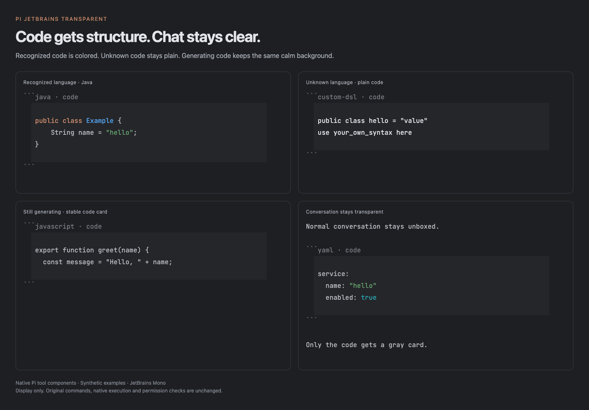
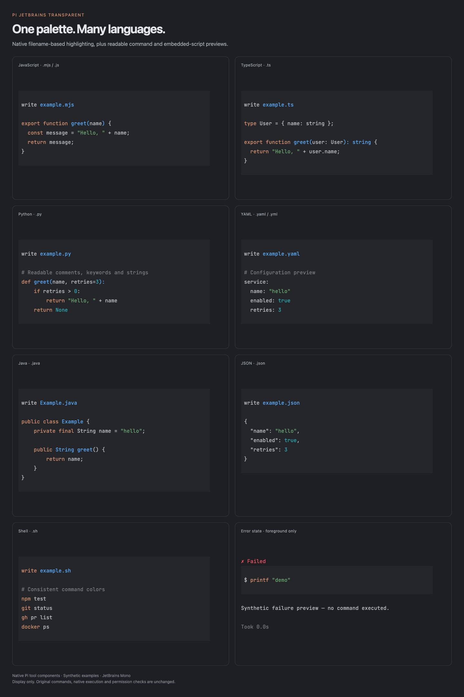

# Pi JetBrains Transparent

Transparent conversation, quiet gray code cards, and JetBrains-inspired colors for [Pi](https://pi.dev/).



## What you get

- **Two themes:** `jetbrains-dark-transparent` and `darcula-transparent`.
- **Consistent code cards:** recognized code gets syntax colors; unknown code stays plain and readable on the same gray background.
- **Readable plain text:** brighter text in plain/unknown Markdown cards, with UUIDs and formatted dates/times accented in the keyword color. These are visual pattern matches, not data validation. Programming-language strings retain their syntax colors.
- **Stable generation:** code keeps its card while it streams. Completed commands and Markdown blocks get the enhanced highlighting.
- **Consistent commands:** executable names such as `npm`, `git`, `gh`, `docker`, and custom commands share the keyword color in shell previews. Arguments, strings, comments, and runtime output keep their own styles.
- **Readable scripts:** Bash commands and literal Python, Node.js, shell, and SSH-stdin heredocs.
- **Native file previews:** Pi keeps its filename-based highlighting for JavaScript, TypeScript, Python, YAML, Java, JSON, shell, and other supported formats.
- **Clear failures:** a red `✗ Failed` label, not a red message panel.

This is display-only. It does not replace execution, add model tools, change providers or permissions, rewrite executed commands, or modify transcript text. Ordinary runtime output is not guessed to be source code.

## Install

```sh
pi install npm:pi-jetbrains-transparent
```

Run `/reload`, then open `/settings` → **Theme** and select either theme. Arrow keys preview themes; Enter keeps the selection and Esc cancels.

Run `/command-colors` to check that the renderer is enabled. If you previously installed a manual copy, disable that copy before installing this package to avoid duplicate renderers and commands.

Requires Pi's renderer and Markdown-transformer APIs. Tested on **Pi 1.5.2 and 1.6.0 on macOS**; other platforms are not yet verified.

## Gallery

[JetBrains Dark overview](docs/screenshots/jetbrains-overview.png) · [Darcula overview](docs/screenshots/darcula-overview.png) · [Same-command comparison](docs/screenshots/before-after.png) · [Failure state](docs/screenshots/failure-state.png)



These are real browser captures of native Pi components rendered in an isolated xterm.js gallery with synthetic examples—not full agent-session screenshots. Demo commands are not executed. The gallery uses JetBrains Mono; your terminal controls its own font and background. This package does not install fonts or change terminal opacity.

## Deliberate limits

- Language detection uses explicit fence labels, filenames, and recognized interpreters—not guesses from ordinary prose or logs.
- Markdown cards cover standard top-level fenced blocks. Indented or nested Markdown fences retain native rendering. Display fence labels include `· code` so Pi does not highlight the already-styled display lines twice.
- Complex or unclosed shell heredocs retain Bash highlighting; arbitrary quoted SSH commands are not decoded or reformatted. Prefer readable multiline stdin scripts for the best previews.
- Commands over 50,000 characters remain plain. Rendering never truncates or changes the command itself.
- Self-framed/custom tool components and tools without registered call renderers may keep their own presentation. Image results are not wrapped as code.
- Dark themes use charcoal cards; light themes use light gray. The companion themes keep normal and error message backgrounds transparent.

## Remove

Switch to a built-in theme first, then:

```sh
pi remove npm:pi-jetbrains-transparent
```

Run `/reload`.

## Develop

From a source checkout, with an npm-installed Pi on your PATH:

```sh
npm ci --ignore-scripts --legacy-peer-deps
npm test
npm run typecheck
npm run screenshots
```

Screenshot capture uses a fresh headless Chrome profile. Set `CHROME_PATH` if Chrome is not at the default macOS location. No signed-in browser profile or model account is used by the demos.

## License

MIT: free to use, modify, and redistribute, including commercially, subject to the license notice. See [LICENSE](LICENSE) and [NOTICE.md](NOTICE.md).

Community-made and not affiliated with or endorsed by JetBrains. Palette-inspired highlighting is not an IDE semantic engine.
